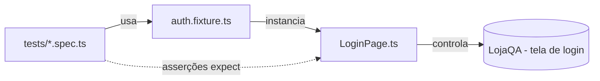

<div align="center">

# 🛒 LojaQA — Automação E2E de Login

**Suíte de testes profissionalizada com Page Object Model, Fixtures e Data-Driven**


[🌐 Aplicação alvo](https://alisonmelo.github.io/tioalison-pe-t4-fap26/projetos-base/01-sistema-login/login.html) ·
[🚀 Como executar](#-como-executar) ·
[🏗️ Arquitetura](#️-arquitetura) ·
[🧪 Cobertura](#-cobertura-de-testes)

</div>

---

## 📖 Sobre o projeto

A suíte legada de login tinha **seletores CSS espalhados por vários arquivos de teste**, o que gerava alto custo de manutenção a cada mudança de layout ou de classes no frontend.

Esta refatoração concentra o conhecimento da tela em **um único lugar** (o Page Object). Se um seletor mudar, **só um arquivo precisa ser alterado**.

| | Antes | Depois |
|---|---|---|
| Seletores | Espalhados em vários testes | Encapsulados em `LoginPage` |
| Setup | Repetido em cada teste | Reutilizado via fixtures |
| Variações de dados | Testes duplicados | Um array + loop `for...of` |

---

## 🏗️ Arquitetura

```
meu-projeto-playwright/
├── 📁 pages/
│   └── LoginPage.ts                  → Page Object (seletores encapsulados, sem asserções)
├── 📁 fixtures/
│   └── auth.fixture.ts               → Fixtures customizadas (base.extend) + massa de dados
├── 📁 tests/
│   ├── login-pom.spec.ts             → Testes E2E consumindo o Page Object
│   └── login-data-driven.spec.ts     → Cenários dinâmicos em loop for...of
├── playwright.config.ts
└── package.json
```



> Os testes **nunca** conhecem seletores CSS. Eles falam apenas com métodos e Locators do Page Object.

---

## 🧩 Os três padrões aplicados

### 1️⃣ Page Object Model — `pages/LoginPage.ts`

- Injeção de dependência: `constructor(private page: Page)`
- Elementos encapsulados e privados: `#email`, `#password`, `#loginBtn`, `#errorMessage`, `#statusMessage`
- Ações: `goto()` e `login(email, password)`
- Locators expostos para validação: `email`, `password`, `submitButton`, `error`, `status`
- **Regra de ouro:** nenhuma asserção dentro da classe ✅

```ts
const loginPage = new LoginPage(page);
await loginPage.goto();
await loginPage.login('user@system.com', 'UserPassword123');
await expect(loginPage.error).toBeHidden();
```

### 2️⃣ Fixtures — `fixtures/auth.fixture.ts`

Criadas com `base.extend`, entregam o estado pronto para o teste:

| Fixture | O que entrega |
|---|---|
| `loginPage` | `LoginPage` instanciada, com a tela de login já aberta |
| `clienteLogado` | Cliente já autenticado, fora da tela de login |

A massa de dados fica centralizada em `USUARIOS` (admin, cliente, lojista e bloqueado).

### 3️⃣ Data-Driven — `tests/login-data-driven.spec.ts`

Um array de cenários gera os testes sem duplicar código:

```ts
for (const cenario of cenarios) {
  test(`login: ${cenario.nome}`, async ({ page, loginPage }) => {
    await loginPage.login(cenario.email, cenario.senha);
    // valida sucesso ou erro conforme o cenário
  });
}
```

---

## 🧪 Cobertura de testes

**`login-pom.spec.ts`**

| Cenário | Tipo | Validação |
|---|---|---|
| Cliente válido | Caminho feliz | Redireciona para fora da tela de login |
| Senha incorreta | Caminho triste | Mensagem de erro visível |
| Botão inicial | Regra de negócio | Botão **Entrar** inicia desabilitado |
| Fixture `clienteLogado` | Fixture | Cliente já autenticado |
| Fixture `loginPage` | Fixture | Tela pronta e botão desabilitado |

**`login-data-driven.spec.ts`**

| Perfil | Resultado esperado |
|---|---|
| ✅ Cliente válido | Login com sucesso |
| ✅ Admin válido | Login com sucesso |
| ✅ Lojista válido | Login com sucesso |
| ❌ Senha incorreta | Mensagem de erro |
| ❌ Usuário bloqueado | Mensagem de erro |

---

## 🚀 Como executar

**Pré-requisito:** Node.js 18 ou superior.

```bash
# 1. Instalar dependências
npm install

# 2. Baixar o navegador do Playwright (somente na primeira vez)
npx playwright install chromium

# 3. Rodar os testes
npm test
```

### Outros comandos úteis

| Comando | Descrição |
|---|---|
| `npm test` | Executa todos os testes (headless) |
| `npm run test:headed` | Executa com o navegador visível |
| `npm run test:ui` | Abre o modo interativo do Playwright |
| `npm run report` | Abre o relatório HTML |
| `npm run typecheck` | Valida a tipagem com o TypeScript |
| `npx playwright test tests/login-pom.spec.ts` | Roda apenas um arquivo |

---

## 🔑 Massa de dados

Usuários de teste disponibilizados pela própria LojaQA:

| Perfil | E-mail | Senha |
|---|---|---|
| Admin | `admin@system.com` | `AdminPassword123` |
| Cliente | `user@system.com` | `UserPassword123` |
| Lojista | `lojista@system.com` | `SellerPass123` |
| Bloqueado | `blocked@system.com` | `Blocked123` |

> São credenciais fictícias de um ambiente de estudo, expostas na própria tela de login.

---

## 🎓 Contexto acadêmico

Atividade prática da disciplina **Automação de Testes E2E com Playwright & TypeScript** (Unidade 14, Aulas 37 e 38).

<div align="center">

Feito com 💙 e muito `await`.

</div>